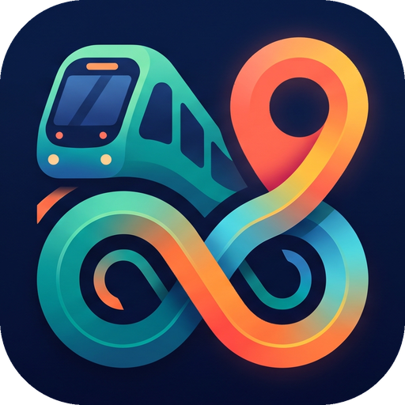

<p align="center"></p>

<h1 align="center">Navi</h1>

<p align="center">The free navigator for trains, buses and trams across Germany.<br>
Live departures, journey planning, station maps and step-free routes – no ads, no tracking.</p>

<p align="center"><a href="https://taynotfound.github.io/navi/">Website</a> · <a href="https://github.com/taynotfound/navi/releases/latest">Download APK</a> · <a href="https://ko-fi.com/taygotkofi">Support on Ko-fi</a></p>

---

## What it does

- **Journeys** door to door, across every transport network in Germany (DB, VSN, VSB, …), with step-free and bike options.
- **Live departure boards**: delays, platform changes, cancellations and operator notices straight from Deutsche Bahn, plus every bus and tram.
- **Live trips**: saved and open journeys refresh themselves and tell you what to do next ("Change at Fulda · platform 3 → 5 · 8 min left").
- **Share a trip** as a link – the recipient sees it live in the browser, no app needed.
- **Station info**: lifts and escalators with live status, platforms, toilets and entrances on a map.
- **Frag Navi**: ask in your own words ("next train to Kassel?"). A small assistant on free OpenRouter models answers from live data – and only about public transport and the app.
- **Material 3 Expressive** design, dark by default, English and German, first-launch setup.

## How it fits together

```
Android app (Kotlin · Jetpack Compose · Material 3 Expressive · MapLibre)
        │  only talks to the Navi server
        ▼
Navi server (Go, no dependencies) — https://navi-api.taymaerz.de
 ├─ DB OpenBoards   live departure/arrival boards        (cached per station & minute)
 ├─ DB FaSta        live lift & escalator status          (cached 2 min)
 ├─ DB OpenStation  station data, NeTEx dump, CC0          (downloaded daily)
 └─ MOTIS           routing + all local transport          (Transitous by default)
```

The DB API keys stay on the server. The cache keeps the app far below the DB daily quotas, and the server stops calling a DB product before its quota runs out.

## Repository

| Path | What |
|---|---|
| `android/` | The Android app |
| `server/` | The Go API server and its Dockerfile |
| `site/` | The website on GitHub Pages, including the live shared-trip page (`site/trip/`) |
| `.github/workflows/build.yml` | Tests, signed APK on every push, GitHub release on `v*` tags, website to Pages and server to Pelican on `main` |

## Run the server

Needs Go 1.24+ and a [DB API Marketplace](https://developers.deutschebahn.com) account subscribed to **OpenBoards** and **FaSta**.

```sh
cd server
cp .env.example .env        # add DB_CLIENT_ID and DB_API_KEY
go run .                    # http://localhost:8080
```

Or with Docker: `docker compose up -d`. Put it behind HTTPS (Caddy, nginx or a Cloudflare tunnel) and set `TRUST_PROXY=1`.

All settings are in [`server/.env.example`](server/.env.example). `MOTIS_URL` can point to your own [MOTIS](https://github.com/motis-project/motis) instance instead of Transitous.

### API

| Endpoint | |
|---|---|
| `GET /v1/search?q=` | stations, stops, addresses |
| `GET /v1/nearby?lat=&lon=` | stops around a point |
| `GET /v1/board?stop=&arrivals=1` | live departures / arrivals |
| `GET /v1/plan?from=&to=&time=&arriveBy=1&wheelchair=1&bike=1` | journeys (`from`/`to` = stop id or `lat,lon`) |
| `GET /v1/trip?id=` | one vehicle's run |
| `GET /v1/station?stop=` | station info with live lift status |
| `POST /v1/live` | refresh an itinerary with live data |
| `POST /v1/assistant` | "Frag Navi" (needs `OPENROUTER_API_KEY`; free models only, transit topics only) |
| `POST /v1/share`, `GET /v1/share?id=` | share links (kept 7 days); they open `site/trip/?id=` |

## Build the app

Needs JDK 21 and the Android SDK (platform 37.1).

```sh
cd android
./gradlew assembleDebug -PnaviApi=http://10.0.2.2:8080   # emulator → server on your machine
```

`naviApi` is the server URL baked into the app. Shared-trip links (`https://taynotfound.github.io/navi/trip/?id=…`) open in the app when it is installed.

### Releases

Every push builds a signed APK (`versionCode` = build number). Tag `vX.Y.Z` to publish a GitHub release.

Repository secrets: `NAVI_KEYSTORE_BASE64`, `NAVI_KEYSTORE_PASSWORD`, `NAVI_KEY_ALIAS`, `NAVI_KEY_PASSWORD`, `PELICAN_API_KEY`.
Repository variable: `NAVI_API` (defaults to `https://navi-api.taymaerz.de`).

## Website

Plain HTML/CSS in `site/`, no build step, deployed to GitHub Pages. Design notes: [DESIGN.md](DESIGN.md). Preview locally with `python3 -m http.server -d site 8091` (it talks to a dev server on port 8090).

## Data & credits

- Deutsche Bahn – OpenBoards, FaSta, OpenStation (CC0) via the [DB API Marketplace](https://developers.deutschebahn.com)
- [Transitous](https://transitous.org) / [MOTIS](https://github.com/motis-project/motis) with DELFI timetables
- Map data © [OpenStreetMap](https://www.openstreetmap.org/copyright) contributors, tiles by [OpenFreeMap](https://openfreemap.org), rendered with [MapLibre](https://maplibre.org)

Navi is not affiliated with Deutsche Bahn.

## License

[AGPL-3.0-or-later](LICENSE). See [AI-DECLARATION.md](AI-DECLARATION.md) for how AI was used to build Navi.
